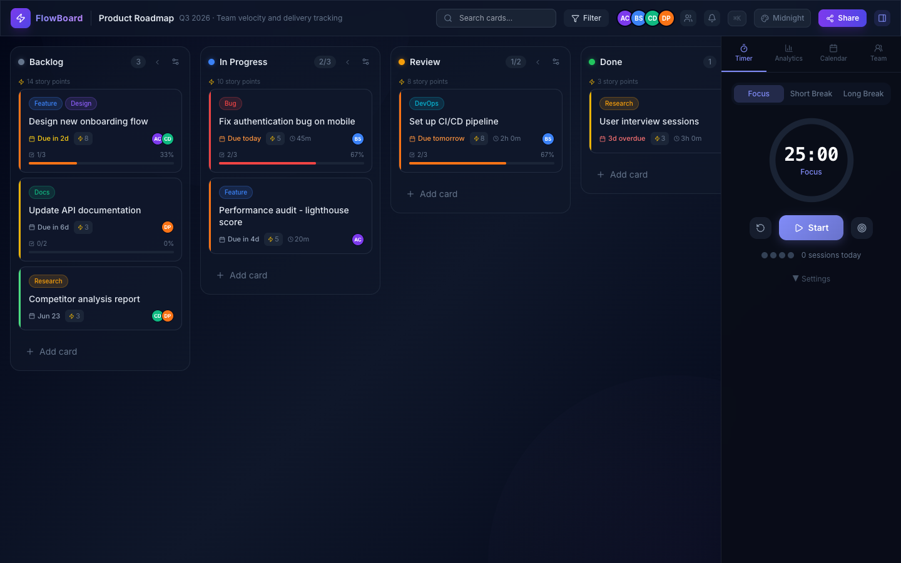
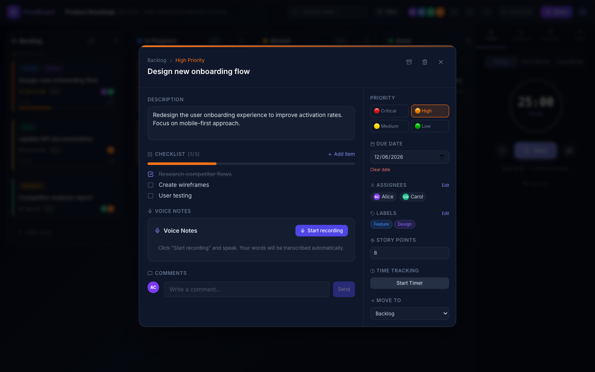
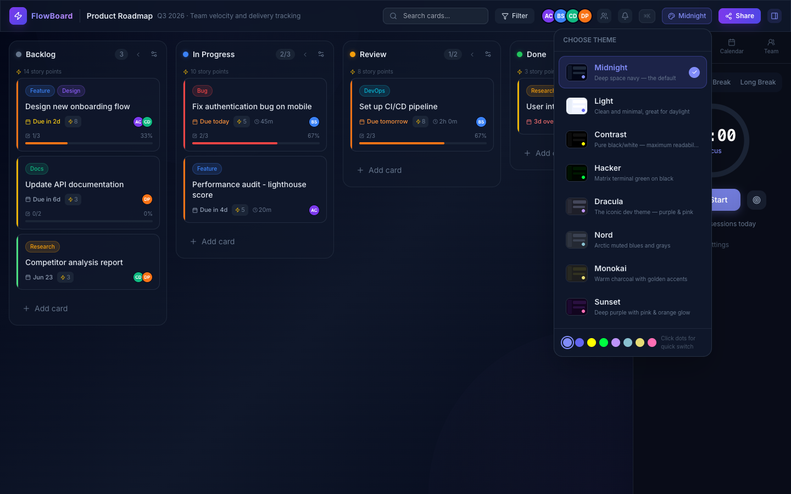
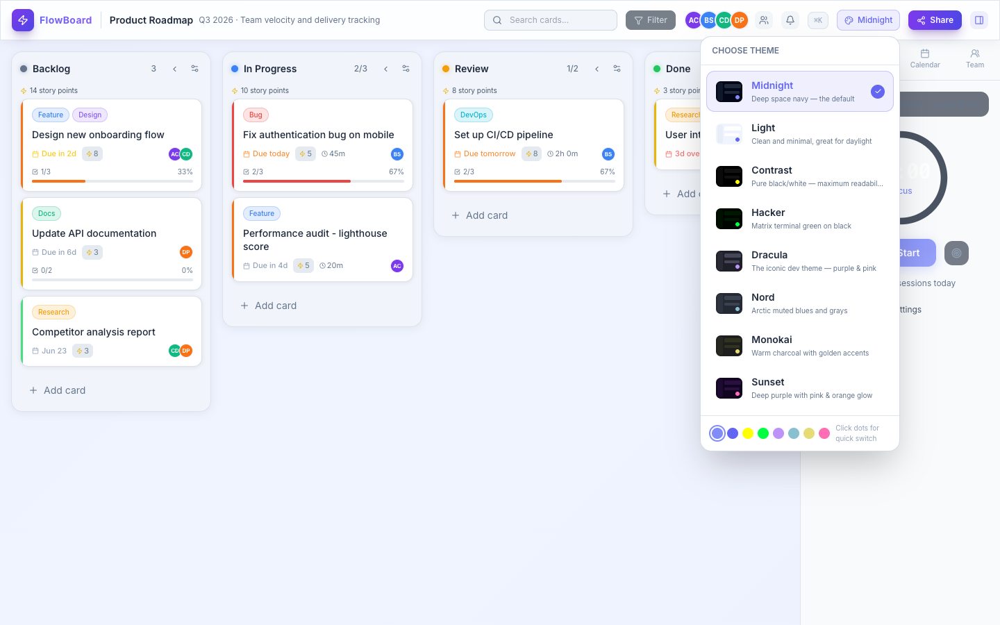
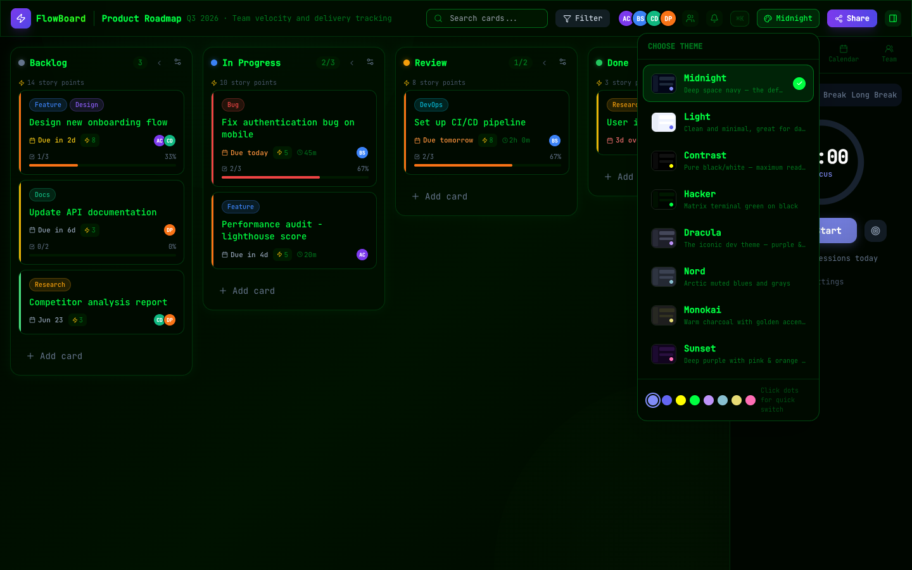

# FlowBoard — Kanban Project Manager

A full-featured, beautiful Kanban board built with React 18, TypeScript, and Tailwind CSS. Manage work visually with drag-and-drop columns, priority tracking, team collaboration, voice notes, analytics, and 8 hand-crafted themes.

Runs in two modes from the same codebase:
- **Local mode** (zero config) — board lives in your browser, no login, no backend. Perfect for solo use or a quick try.
- **Team mode** (optional Supabase backend) — login, multiple boards, team workspaces, email invites with roles, and **realtime multiplayer** sync.

[](https://vercel.com/new/clone?repository-url=https%3A%2F%2Fgithub.com%2FTheProtagonist07%2Fflowboard-kanban&env=VITE_SUPABASE_URL,VITE_SUPABASE_ANON_KEY&envDescription=Supabase%20URL%20%26%20anon%20key%20(leave%20blank%20for%20local%20mode)&envLink=https%3A%2F%2Fgithub.com%2FTheProtagonist07%2Fflowboard-kanban%2Fblob%2Fmain%2Fsupabase%2FREADME.md)



---

## Features

### Core Board
- **Drag-and-drop** cards between columns and reorder columns themselves
- **WIP limits** — set a max card count per column; exceeded limits highlight in red
- **Collapsible columns** — collapse any column down to a slim vertical strip
- **Live search** — filter cards across all columns instantly
- **Multi-filter** — filter by priority, assignee, label, or overdue status simultaneously

### Cards
- **Priority levels** — Critical, High, Medium, Low with colour-coded left-border indicators
- **Subtask checklists** with progress bar and completion percentage
- **Due dates** with relative display ("Due in 2d", "Due today") and overdue pulsing badge
- **Story points** for effort estimation (shown per-card and totalled per-column)
- **Time tracking** — built-in timer to log time spent on each card
- **Labels** — colour-tagged labels for categorisation
- **Assignees** — assign multiple team members per card
- **Comments** — threaded comments with timestamps
- **Move to column** — quickly reassign a card to any column from the modal
- **Archive** — archive completed cards without deleting them



### Voice Notes
Record spoken notes directly on any card using the browser's built-in Web Speech API — no API key or microphone app required. Works natively in Chrome and Edge.

### Team Collaboration
- Add and manage team members with custom colours and initials
- Assign members to cards; see avatar stacks on the board
- Team view in the sidebar shows every member's active tasks and overdue count
- **Board sharing** — share the entire board state via a single URL (base64-encoded JSON — no backend needed)

### Productivity Tools

| Tool | Description |
|------|-------------|
| **Pomodoro Timer** | 25/5/15-min work and break cycles with auto-transitions and notification alerts |
| **Analytics** | Cards by priority, WIP per column, overdue counts, team workload charts |
| **Calendar View** | Monthly calendar showing all due dates at a glance |
| **Command Palette** | `⌘K` — search cards, jump to columns, create new cards, open sidebar views |
| **Deadline Notifications** | Browser push notifications for cards due today or overdue |

### 8 Themes

Switch themes live from the header — your choice persists across sessions.



| Theme | Description |
|-------|-------------|
| **Midnight** | Deep space navy — the default dark mode |
| **Light** | Clean white canvas, great for bright environments |
| **Contrast** | Pure black/white with yellow and cyan accents — maximum readability |
| **Hacker** | Matrix terminal green on black, switches to JetBrains Mono font |
| **Dracula** | The iconic dev theme — purple & pink on dark |
| **Nord** | Arctic muted blues and greys |
| **Monokai** | Warm charcoal with golden and green accents |
| **Sunset** | Deep purple with pink & orange glow |

| Light Theme | Hacker Theme |
|:-----------:|:------------:|
|  |  |

---

## Tech Stack

| Layer | Technology |
|-------|-----------|
| Framework | React 18 + TypeScript |
| Build tool | Vite |
| Styling | Tailwind CSS v3 + CSS custom properties |
| State | Zustand with `persist` middleware (localStorage) |
| Backend (team mode) | Supabase — Postgres, Auth, Row-Level Security, Realtime |
| Drag-and-drop | `@hello-pangea/dnd` |
| Icons | Lucide React |
| Toasts | react-hot-toast |
| Voice | Web Speech API (browser-native) |
| Notifications | Web Notifications API (browser-native) |
| Deploy | Vercel (frontend) + Supabase (data) |

---

## Getting Started

### Prerequisites
- Node.js 18+
- npm or pnpm

### Install & Run

```bash
# Clone
git clone https://github.com/TheProtagonist07/flowboard-kanban.git
cd flowboard-kanban

# Install dependencies
npm install

# Start dev server
npm run dev
# → http://localhost:5174
```

That runs **local mode** — no account needed. To enable **team mode**, see
[Team Mode](#team-mode-cloud) below.

### Build for Production

```bash
npm run build       # TypeScript check + Vite bundle → dist/
npm run preview     # Serve the built dist locally
```

---

## Project Structure

```
src/
├── components/
│   ├── Board.tsx          # DnD context, column layout
│   ├── Column.tsx         # Column header, WIP, collapse, add-card
│   ├── KanbanCard.tsx     # Card tile with priority bar, meta, assignees
│   ├── CardModal.tsx      # Full card detail: checklist, voice, comments
│   ├── Header.tsx         # Search, filter, members, theme picker, share
│   ├── Sidebar.tsx        # Tab container for sidebar panels
│   ├── PomodoroTimer.tsx  # Work/break timer with notifications
│   ├── Analytics.tsx      # Charts and board metrics
│   ├── CalendarView.tsx   # Monthly due-date calendar
│   ├── TeamView.tsx       # Team member task overview
│   ├── ThemePicker.tsx    # 8-theme live switcher with swatches
│   ├── CommandPalette.tsx # ⌘K fuzzy search / action launcher
│   ├── ShareModal.tsx     # Board share-link generator
│   ├── CloudUI.tsx        # Board switcher, account menu, invite modal (team mode)
│   ├── Login.tsx          # Auth screen (team mode)
│   └── VoiceInput.tsx     # Web Speech API recorder
├── lib/
│   ├── supabase.ts        # Supabase client + CLOUD mode flag
│   ├── auth.tsx           # AuthProvider + useAuth (session, sign in/out)
│   └── cloud.ts           # Boards/workspaces/invites + load/save + realtime
├── store.ts               # Zustand store — board state, actions, cloud wiring
├── types.ts               # TypeScript interfaces
├── utils.ts               # Helpers: encode/decode, filters, dates, notifications
├── index.css              # 8 theme variable blocks + global styles
└── App.tsx                # Root gate (auth + board load), layout, shortcuts

supabase/
├── migrations/0001_init.sql  # Schema, RLS, triggers, realtime
└── README.md                 # Team-mode setup guide

api/                        # Optional REST API + Discord bot bridge
bot/                        # Discord.js slash-command bot
```

---

## Keyboard Shortcuts

| Shortcut | Action |
|----------|--------|
| `⌘K` / `Ctrl+K` | Open command palette |
| `Esc` | Close command palette / card modal / share modal |
| `Enter` (in add-card textarea) | Save new card |
| `↑↓` (in command palette) | Navigate results |

---

## Team Mode (Cloud)

Team mode adds accounts, shared boards, and live multiplayer on top of the same UI — backed by [Supabase](https://supabase.com) (Postgres + Auth + Realtime).

### What you get
- **Accounts** — Google or email/password sign-in
- **Workspaces & roles** — owner / editor / viewer per workspace
- **Multiple boards** — switch boards from the header; each is stored server-side
- **Email invites** — invite teammates by email (auto-joined on sign-in) or via a copyable invite link
- **Realtime multiplayer** — card moves and edits appear on everyone's screen instantly
- **Row-Level Security** — people only ever see boards in workspaces they belong to

### Setup (~5 minutes)
1. Create a free Supabase project.
2. Paste [`supabase/migrations/0001_init.sql`](supabase/migrations/0001_init.sql) into the Supabase **SQL Editor** and run it.
3. Copy your project URL + anon key into `.env` (see [`.env.example`](.env.example)).
4. `npm run dev` — you'll now get a login screen and cloud-backed boards.

Full step-by-step (auth providers, redirect URLs, schema reference): [`supabase/README.md`](supabase/README.md).

### Deploy your own
Click the **Deploy with Vercel** button at the top. Vercel will fork the repo and prompt for `VITE_SUPABASE_URL` / `VITE_SUPABASE_ANON_KEY` (leave blank to deploy in local mode). Add your deployed URL to Supabase's **Auth → Redirect URLs**.

> **How it works:** the in-memory board shape is unchanged — each board's columns/cards/labels are stored as a JSONB document in Postgres, while accounts, workspaces, memberships and invites are fully normalized tables with RLS. Writes are debounced to the server; remote changes stream back over Supabase Realtime with echo-suppression so you never fight your own edits.

---

## Board Sharing

Click **Share** in the header to generate a shareable URL. The entire board state (columns, cards, members, labels) is base64-encoded into the URL query string — no server or account required. Anyone who opens the link gets a full copy of the board imported into their local state. *(Local mode; in team mode, share a board by inviting teammates to its workspace.)*

---

## License

MIT © [Shivam Chaurasia](https://github.com/TheProtagonist07)
